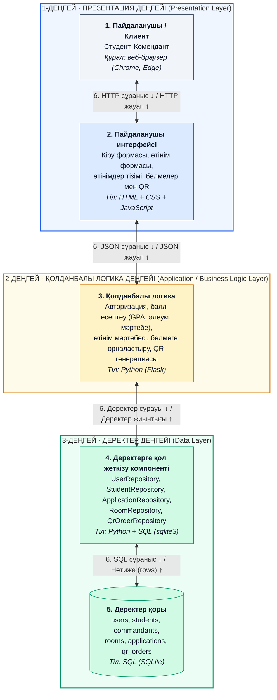

## Деңгейлер және тілдер

| Деңгей | Компонент | Тіл |
|---|---|---|
| 1. Презентация | Клиент | Веб-браузер |
| 1. Презентация | Пайдаланушы интерфейсі | HTML, CSS, JavaScript |
| 2. Қолданбалы логика | Бизнес-логика | Python (Flask) |
| 3. Деректер | Деректерге қол жеткізу | Python + SQL |
| 3. Деректер | Деректер қоры | SQL (SQLite) |
